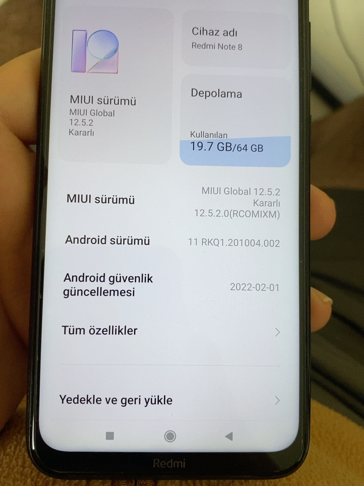
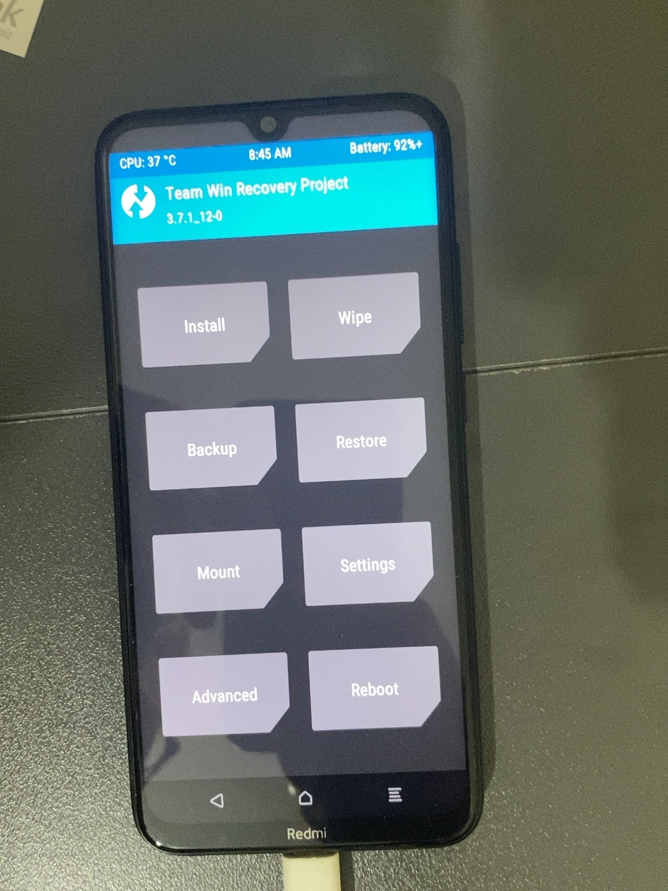
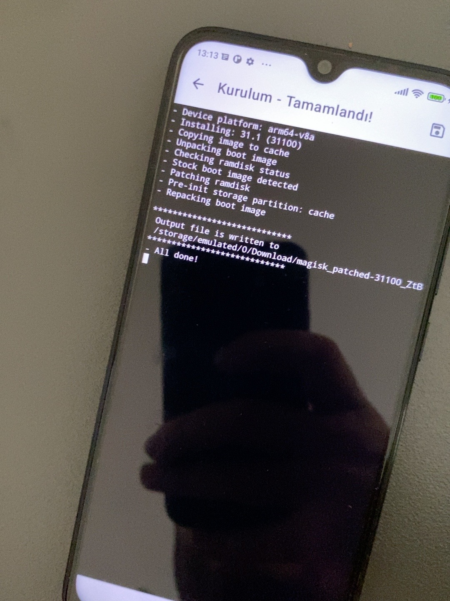
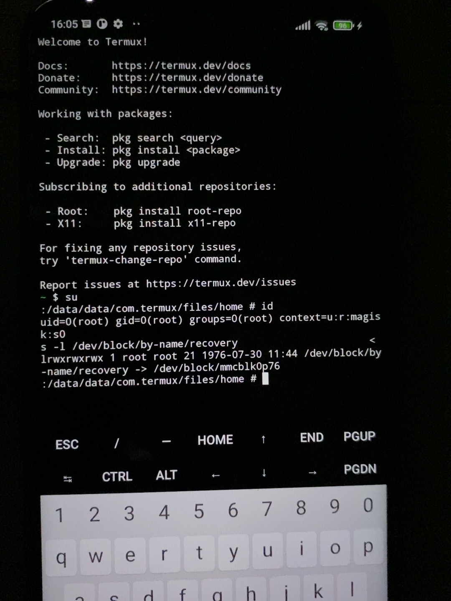

# Redmi Note 8 — Kurulum günlüğü

Bu günlük, telefonun laboratuvara dönüştürülmesi sırasında tutulan çalışma notlarını ve incelenen ekran fotoğraflarını bir araya getirir. Bir yeniden kurulum reçetesi değildir. Kesin kurulum sırası ve her işlemin tarihi tam olarak kayıtlı olmadığından aşamalar konu sırasıyla sunulmuştur. Dosyaların yüklenme tarihi, işlemin kesin tarihi olarak kullanılmamıştır.

## Kanıt durumu

| Aşama | Kayıt |
| --- | --- |
| Başlangıç sistemi | Görsel 05: Redmi Note 8, MIUI 12.5.2, Android 11 |
| Bootloader kilidi açma | İşlemin yöntemi, zamanı ve başarı ekranı bu günlükte doğrulanmadı |
| Fastboot ile TWRP boot etme | İncelenen terminal fotoğrafında gönderim ve boot için OKAY görülüyor |
| TWRP açılışı | Görsel 06: TWRP 3.7.1_12-0 ana menüsü |
| ArrowOS Android 13 | Önceki çalışma notunda kurulduğu bildirildi; bu seçkide sürüm/kurulum ekranı yok |
| Magisk 31.1 ile boot imajını yamalama | Görsel 07: yamalama tamamlanmış, çıktı dosyası oluşturulmuş |
| Termux root erişimi | Görsel 08: su sonrasında uid=0 ve Magisk bağlamı görülüyor |
| Kali/NetHunter | Önceki çalışma kaydı ve [güncelleme galerisi](../evidence/README.md) |

## 1. Başlangıç — MIUI

Telefon modeli Redmi Note 8; çalışma notundaki cihaz kod adı `ginkgo`. İncelenen başlangıç ekranında MIUI Global 12.5.2 Kararlı, `12.5.2.0(RCOMIXM)` ve Android 11 görülüyor. Bu, tarihsel başlangıç durumudur; telefonun bugünkü sürümünü gösterdiği iddia edilmez.



## 2. Bootloader, fastboot ve TWRP

**Bootloader kilidini açmak**, **bir imajı boot etmek** ve **bir bölüme kalıcı olarak yazmak** ayrı işlemlerdir.

İncelenen Windows terminal fotoğrafında TWRP imajını kullanan `fastboot boot` komutu, ardından aşağıdaki başarılı çıktı görülüyor:

```text
Sending 'boot.img' (65536 KB)   OKAY
Booting                       OKAY
Finished. Total time: 1.680s
```

Aynı fotoğrafta `fastboot devices` ile cihazın listelenmesi ve `fastboot reboot` için `OKAY` sonucu da var. Fotoğraf cihaz seri numarası içerdiğinden burada yalnızca gerekli çıktı aktarılmıştır. İmaj dosyasının tam adı kadrajdan güvenilir biçimde okunamadığı için eksiksiz komut uydurulmamıştır.

Bu kayıt TWRP'nin boot edildiğini destekler; tek başına kalıcı recovery kurulumunu veya bootloader kilidinin hangi yöntemle açıldığını kanıtlamaz.

Aşağıdaki fotoğraf TWRP **3.7.1_12-0** ana menüsünün açıldığını gösterir. Önceki notlarda TWRP dosyası için SHA-256 kontrolü yapıldığı belirtilmiştir; gerçek hash değeri bu günlükte mevcut değildir.



## 3. ArrowOS ve sistemin başlaması

Önceki çalışma kaydında MIUI'den ArrowOS Android 13'e geçildiği belirtilmiştir. Ancak bu görsel seçkisinde ROM kurulumu başarı ekranı veya ArrowOS sürüm sayfası yoktur.

Bu nedenle bölümün durumu **çalışma notuyla kayıtlı, görselle doğrulanmadı** olarak tutulur. Wipe seçimleri, ROM ZIP dosyasının tam adı, flash komutları ve ilk açılış süresi kayıtlardan kesin olarak çıkarılamadığından eklenmemiştir. Yeniden başlatmada Redmi logosunun görülmesi tek başına hangi ROM'un çalıştığını belirlemez.

## 4. Magisk ile boot imajını yamalama

Görselde Magisk **31.1 (31100)** için boot imajını açma, ramdisk kontrolü, yamalama ve yeniden paketleme adımları görülüyor. Çıktı dosyası Download klasörüne yazılmış ve `All done!` mesajı alınmış.

Bu ekran **yamalı dosyanın oluşturulduğunu** doğrular; tek başına o dosyanın telefona flash edildiğini doğrulamaz.



## 5. Termux root erişimi ve sorun giderme

Çalışma sırasında `Permission denied`, `No such file or directory` ve `No su program found` türü hatalar kaydedildi. Her hata için tek bir kök neden doğrulanmış değildir.

İncelenen ara aşama fotoğrafında `/debug_ramdisk/su` doğrudan çağrıldığında `uid=0` alınırken düz `su` komutu bulunamıyordu. Bu, o anda root erişiminin bir yoldan sağlanabildiği fakat normal komut yolunun sorunlu olduğu ayrımını gösterir. Ara aşamadaki betik düzenleme denemesi genel çözüm olarak önerilmemiştir.

Sonraki seçilmiş görüntüde `su` ardından `id` çalıştırılmış ve şu sonuç görülüyor:

```text
uid=0(root) gid=0(root) groups=0(root) context=u:r:magisk:s0
```



| Komut | Amaç | Flag |
| --- | --- | --- |
| `su` | Yetkili root kabuğuna geçiş | Yok |
| `id` | Etkin kullanıcı ve grup kimliğini görmek | Yok |

Bu kanıt Android/Termux root kabuğuna aittir. Kali ortamındaki kullanıcı kimliği veya NetHunter kernel özellikleriyle aynı doğrulama değildir.

## 6. NetHunter bileşenleri ve Kali terminali

Önceki kayıtlarda NetHunter Store ve BusyBox NDK v1.36.1'in indirildiği, NetHunter uygulamasının görünürlüğü ve terminal eksikliği üzerinde çalışıldığı belirtilmiştir. Terminal eklendikten sonra Kali kabuğunun açıldığı bildirilmiştir.

[Güncelleme ve ağ testleri galerisi](../evidence/README.md), `kali-nethunter-full (2026.4.2)` paketinin yapılandırma satırını, beraberindeki hata mesajlarını ve yerel ping testlerini içerir. Paket adındaki “full” ifadesi, özel kernel, Wi-Fi enjeksiyonu veya USB HID özelliklerinin test edildiğini göstermez.

## Kalan doğrulamalar

- Bootloader kilidi durumunu ve kalıcı recovery durumunu ayrı kaydetmek.
- ArrowOS sürüm ekranını ve varsa ROM kurulum başarı kaydını eklemek.
- İndirilen kurulum dosyalarının tam adlarını ve doğrulanmış hashlerini arşivlemek.
- NetHunter kernel sürümünü ve desteklenen donanım özelliklerini ayrı test etmek.

## Görsellerin işlenmesi

Görseller 05–08 olarak adlandırıldı. EXIF/açıklama metaverileri kaldırıldı; görüntü piksellerinin kaynaklarla aynı kaldığı kontrol edildi. Terminal yazıları yeniden üretilmedi. Kişisel tanımlayıcı içeren fastboot fotoğrafı yayımlanmadı.

[Proje ana sayfası](../README.md) · [Güncelleme ve ağ galerisi](../evidence/README.md)
