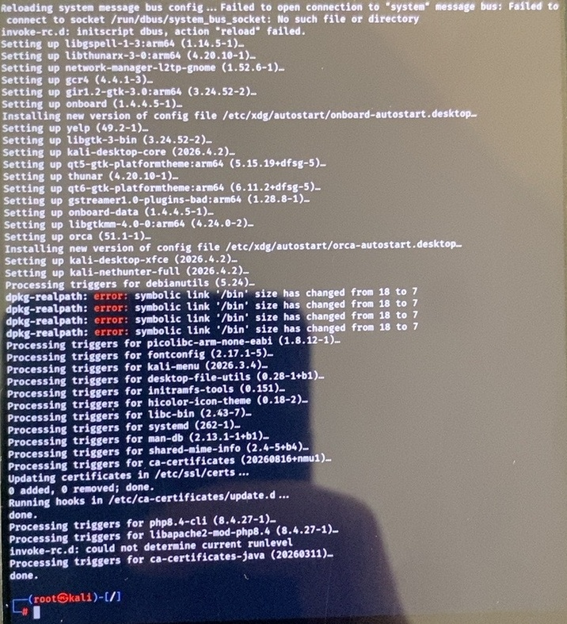
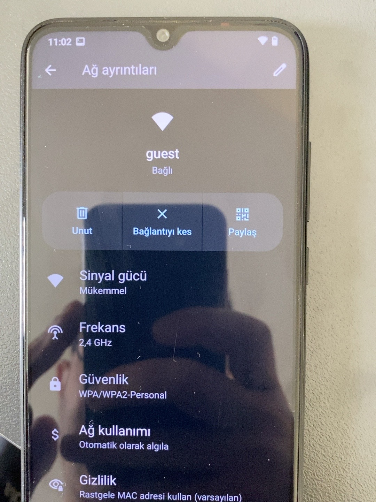
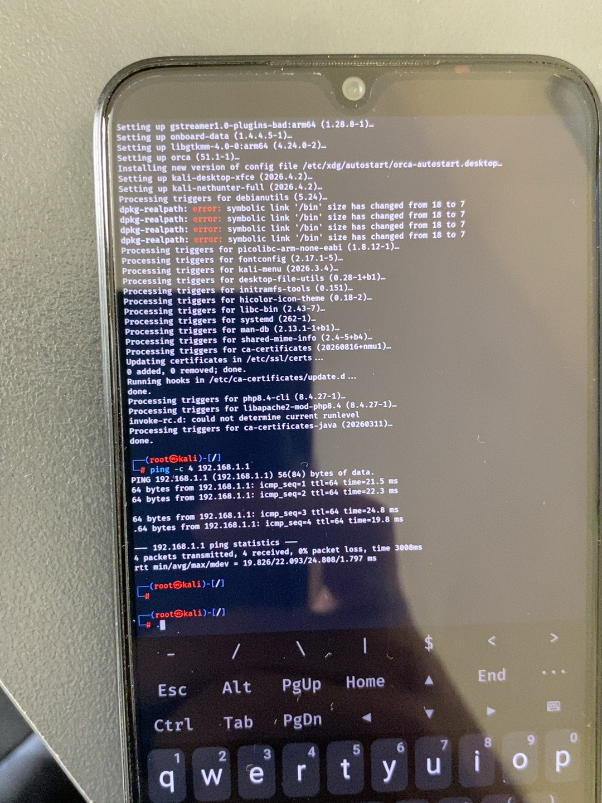
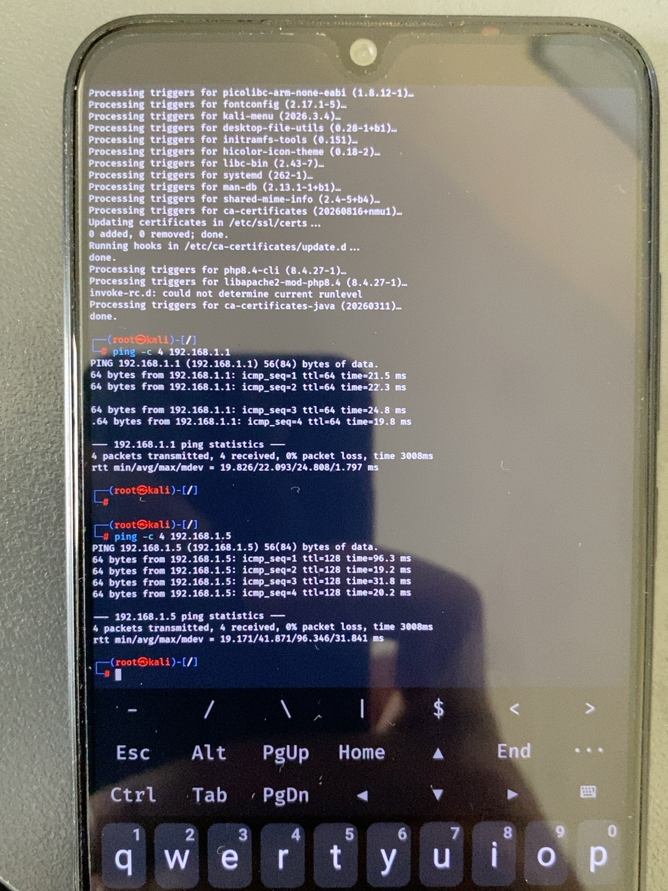

# Ekran görüntüleri ve gözlemler

**Kurulum fotoğrafları 05–08:** [MIUI, TWRP, Magisk ve root erişimi günlüğü](../docs/kurulum-gunlugu.md).

Paylaşılan 15 ekran fotoğrafı incelendi; güncelleme ve ağ testlerini temsil eden 4 görüntü seçildi. Modem yönetim ekranları ve MAC/IPv6 adreslerini içeren ağ ayrıntıları bu galeriye alınmadı.

Görseller numaralandırıldı; EXIF ve diğer açıklama metaverileri kaldırıldı. Görüntüler yeniden üretilmedi, kırpılmadı veya rötuşlanmadı. Kaynak ve yayımlanan dosyaların çözülmüş piksellerinin aynı olduğu kontrol edildi. Aşağıdaki numaralar sunum sırasıdır; çekim zamanının kesin kanıtı değildir.

## 01 — Paket güncelleme çıktısı

`kali-nethunter-full (2026.4.2)` için “Setting up” satırı ve terminal istemine dönüş görünüyor. Bunun yanında `dpkg-realpath` için `/bin` sembolik bağlantı hataları, D-Bus bağlantı hatası ve runlevel uyarısı bulunuyor. Bu görüntü hatasız bir yükseltme veya tüm NetHunter özelliklerinin çalıştığı anlamına gelmez.

## 02 — Misafir ağı bağlantısı

Android ağ ayrıntılarında `guest` ağına bağlı durum, 2.4 GHz ve WPA/WPA2-Personal bilgisi görünüyor. Bu ekran bağlantıyı gösterir; ağlar arasında erişim kısıtlamasının etkin olduğunu kanıtlamaz. “Paylaş” simgesi bir bağlantı QR kodu değildir.

## 03 — Ağ geçidine ping

`ping -c 4 192.168.1.1` sonucunda 4 paket gönderilmiş, 4 yanıt alınmış ve %0 paket kaybı görülmüş. Bu test hedefin ICMP ile erişilebilir olduğunu gösterir.

**Komutun amacı:** Yerel hedefe erişimi kontrol etmek. **Flag:** `-c 4`, testi dört istekle sınırlar.

## 04 — İkinci yerel hedefe ping

Ekranda hem `192.168.1.1` hem `192.168.1.5` için 4/4 yanıt ve %0 kayıp görülüyor. İkinci adresin hangi cihaza ait olduğu bu görüntüden tek başına belirlenemez. Eğer bu hedef ana ağdaki bir cihazsa ve test misafir ağından yapıldıysa, sonuç o hedefe ICMP erişiminin engellenmediğini gösterir. Bu nedenle izolasyon başarısı iddia edilmez.

## Dosya bütünlüğü

SHA-256 değerleri yayımlanan, metaverisi temizlenmiş dosyalara aittir.

| Dosya | SHA-256 |
| --- | --- |
| 01_nethunter_paket_guncelleme.jpeg | `2fd2a41bcb9b09905e7e667f7282694c9664c34663f32ed499d9545228f842e1` |
| 02_android_misafir_agi.jpeg | `6b856d43420c4684f00f5ed304d91931d503ceb06ae20223134a09f6da0b3178` |
| 03_nethunter_ag_gecidi_ping.jpeg | `4a4b5553ebf84dfb32c6b0fd8077868af5f9644231c26e47b474c3a3b2bbf19d` |
| 04_nethunter_yerel_hedef_ping.jpeg | `77817573bb7b5ec98f5092dd76f6b3e18ad705d6de5cfcb06b3c74f8e9644ea9` |

[Proje ana sayfasına dön](../README.md)
